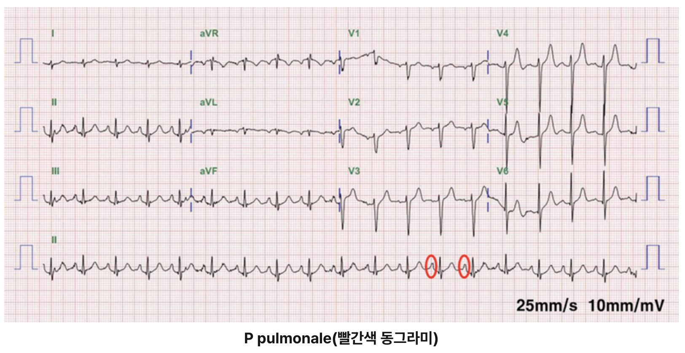
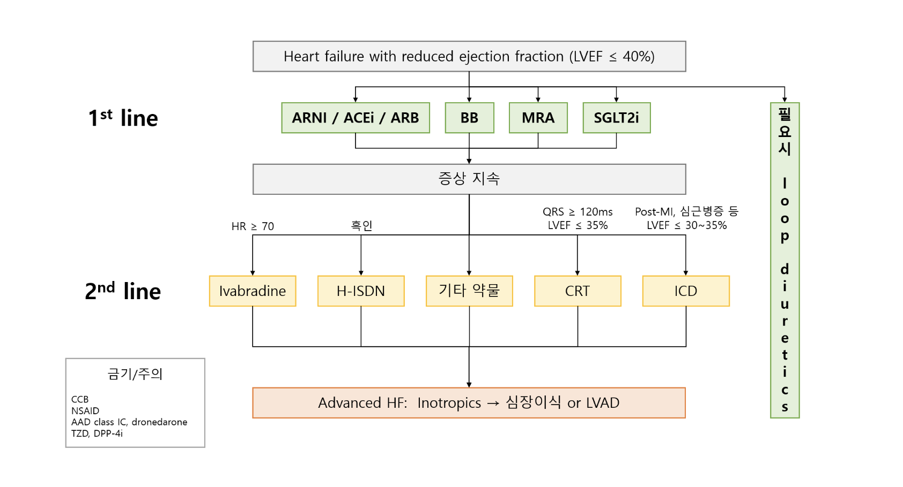

# 순환기 > 심부전

## Exam Snapshot

| Field | High-Yield Answer |
|---|---|
| 정의 | 심부전 (heart failure, HF): 심장 구조/기능 이상으로 충만 또는 박출 장애가 생겨 호흡곤란, 피로, 체액 저류를 보이는 임상 증후군 |
| 전형 단서 | 호흡곤란, 기좌호흡/PND, 피로, S3 gallop, CXR 폐부종, JVP↑, 하지부종 |
| 핵심 사고 | "심부전인가?"에서 끝내지 말고 **원인 질환 + 좌/우심 축 + EF 분류**로 넘어간다 |
| 확인/분류 | BNP/CXR/ECG로 의심 보강 → **Echo로 EF, 판막, 구조, 충만압 확인** |
| 치료 앵커 | 생활습관 + 원인 교정 + 울혈 조절; HFrEF는 예후 개선 약물, ADHF는 산소화/volume/perfusion 안정화 |
| KMLE 보강 | HFrEF 예후 개선 4축(4 pillars) = ARNI/ACEi/ARB + evidence BB + MRA + SGLT2i → MRA 안전성, CRT/ICD trigger는 treatment/trap에서 확인 |
| 우심부전/폐성심 | 만성 폐질환/PH 배경 + 호흡곤란 + JVP↑/부종/간비대/복수면 우심축을 먼저 본다 |

## Disease Flow

| Step | High-Yield Flow | Exam Cue |
|---|---|---|
| 원인/위험인자 | CAD/MI, HTN, 판막질환, 심근병증, 선천성 심질환, 만성 폐질환/PE, 전신질환 → 심장 구조/기능 이상 | 심부전 소견 뒤에 숨어 있는 원인을 찾기 |
| 병태생리 | **좌심부전:** LV dysfunction → ↓CO + ↑LV filling pressure → 폐울혈/저관류 **우심부전/폐혈관 축:** RV dysfunction or ↑PVR → 전신정맥 울혈 | 좌심/우심, forward/backward, HFrEF/HFpEF를 분리 |
| 임상증상/징후 | **폐울혈:** 호흡곤란/기좌호흡/PND, crackles, CXR 폐부종 **전신울혈:** JVP↑, 하지부종, 간비대, 복수 **저박출:** 피로, 어지러움 **청진:** 빈맥, S3 gallop | Allen 요약표의 증상 묶음을 병태생리 축으로 읽기 |
| 진단/검사 | BNP/CXR/ECG → HF 가능성 보강 Echo → EF/판막/구조/충만압 확인 원인/동반질환 의심 시 CT/MRI/RHC/수면다원검사 등 추가 | Echo가 분류와 원인 평가의 중심 |
| 치료 | 생활습관/원인 교정 + 울혈이면 loop **HFrEF(LVEF ≤40%):** ARNI/ACEi/ARB + BB + MRA + SGLT2i **HFpEF/HFmrEF:** 울혈 조절 + 동반질환 관리 **ADHF:** IV loop ± vasodilator/inotrope **Add-on/device:** HR/QRS/post-MI trigger 확인 | Allen 요약표의 치료 항목을 만성/급성/trigger 분기로 읽기 |

<small>출처: Allen 심부전 개요, 원인/증상/진단, 치료 페이지를 기본 골격으로 통합. KMLE는 EF 분류, HFrEF 치료, device/add-on, 문제 함정만 보강.</small>

## Definition and Mechanism

- 심부전은 하나의 원인 질환명이 아니라 여러 심장/폐 질환이 진행되며 생기는 임상 증후군이다.
- 핵심은 심장이 필요한 혈액을 충분히 공급하지 못하거나, 공급하려면 비정상적으로 높은 충만압이 필요한 상태로 이해하는 것이다.
- **좌심부전:** LV dysfunction → ↓cardiac output + ↑LV filling pressure → 저관류와 폐울혈.
- **우심부전/폐혈관 질환:** RV dysfunction 또는 ↑PVR → 전신정맥압↑ → JVP↑, 부종, 간비대.
- CO = SV x HR, EF = SV/EDV, preload/contractility/afterload는 계산 암기보다 증상, echo 분류, 약물 선택으로 연결될 때만 짧게 본다.

<small>출처: Allen 심부전 개요 페이지의 범위 총평을 기본으로 정리. KMLE p.212의 기본 생리 용어는 문제 풀이 연결용으로만 보강.</small>

## Causes and Aggravating Factors

| Cause Group | Examples | Exam Cue |
|---|---|---|
| CAD | MI, ischemic cardiomyopathy | 가장 흔한 원인, 흉통/MI 과거력 |
| HTN | hypertensive heart disease | 오래된 고혈압, LVH |
| Valve disease | MS, MR, AS, AR, TR | 심잡음, 판막 병력 |
| Cardiomyopathy | DCMP, HCMP, RCMP | 심실 확장/비대, 가족력 |
| CHD / Lung disease | VSD, ASD, TOF, COPD, PE | 폐고혈압/폐성심, 우심부전 단서 |
| Systemic stress | 빈혈, 갑상샘중독증, 임신, 감염 | 기존 심부전을 악화시키거나 고박출 상태를 만든다 |

- 악화 요인은 감염, 부정맥, MI, PE, 빈혈, 갑상샘중독증/임신, 고혈압 악화, 심근염, 감염심내막염을 시험용 check-list로 떠올린다.

<small>출처: Allen 원인/진단 페이지를 기본 골격으로 정리. KMLE p.219의 악화 요인 목록을 핵심만 보강.</small>

## Clinical Patterns and Signs

| Pattern | Mechanism Flow | Dominant Clues | Exam Move |
|---|---|---|---|
| 좌심부전 (left HF) | LV dysfunction → ↑LV filling pressure → pulmonary congestion | 호흡곤란, 기좌호흡/PND, crackles, CXR 폐부종 | 폐울혈 증상과 LV/valve 원인을 같이 본다 |
| 우심부전 (right HF) | RV dysfunction or ↑PVR → systemic venous congestion | JVP↑, 하지부종, 간비대, 복수 | 폐질환/PH/PE/좌심부전 전파를 분리 |
| Forward failure | ↓CO → tissue hypoperfusion | 피로, 어지러움, 핍뇨, 차가운 사지 | 저관류/쇼크면 급성 처치 우선 |
| Backward failure | ↑filling pressure → venous congestion | 폐울혈 또는 전신정맥 울혈 | "부종"만 보고 한 축으로 단정하지 않기 |

<small>출처: Allen 심부전 증상/징후 설명을 좌심/우심/forward/backward 문제 풀이 축으로 압축.</small>

## Diagnosis and Tests

| Test | Role | Exam Trap |
|---|---|---|
| CXR | 폐울혈, 심비대, pulmonary artery enlargement 등 보조 단서 | CXR만으로 HF 원인을 확정하지 않기 |
| BNP/NT-proBNP | 심장성 호흡곤란 감별 보조 | 단독 확진 검사는 아님 |
| ECG | MI, AF, LVH, conduction delay, 우심장 부담 단서 | 정상이어도 HF 배제는 어려움 |
| **Echo** | LVEF, LV filling pressure, 판막/구조 이상, RV 기능, PH 단서 | **분류와 원인 평가의 중심 검사** |
| RHC | PH 의심 시 PA pressure, PCWP 등 혈역학 확인 | PH를 PAH로 단정하기 전 left-heart PH를 배제 |
| Cr/K | RAASi, MRA, 이뇨제 안전성 평가 | 약물 문제에서 lab 단서를 먼저 본다 |

<small>출처: Allen 진단 페이지를 기본으로 정리. RHC/Cr/K는 PH 및 치료 선택 문제에서 필요한 만큼만 보강.</small>

## Concept Bridge: EF 기반 심부전 분류

| Item | Core Concept | Why It Matters |
|---|---|---|
| 박출률 감소 심부전 (HFrEF) | **LVEF ≤40%**, 수축 기능↓ | 예후 개선 약물 근거가 가장 뚜렷하다 |
| 박출률 경도 감소 심부전 (HFmrEF) | **LVEF 41-49%** + HF 증상/충만압↑ 근거 | HFrEF와 HFpEF 사이, 일부 치료 근거를 선별 적용 |
| 박출률 보존 심부전 (HFpEF) | **LVEF ≥50%** + HF 증상/충만압↑ 근거 | 울혈 완화, 혈압/AF/CAD/비만/DM 등 동반질환 관리가 중심 |

<small>출처: Allen의 echo 기반 분류 흐름을 기본으로 정리. KMLE p.219-224와 guideline 분류 cutoff를 보강.</small>

## Pulmonary Hypertension and Cor Pulmonale Bridge

Allen 상단 총평의 핵심은 이 파트가 좌심장 중심 심부전 뒤에 이어지는 **우심장/폐혈관 심부전 문제**라는 점이다. 국시에서는 세부 PAH 약물표보다 "만성 폐질환 과거력 + 우심부전 소견"을 먼저 잡는다.

| Item | Core Rule | Exam Cue |
|---|---|---|
| 폐고혈압 (PH) | 폐혈관 압력↑ → RV afterload↑ | 호흡곤란 + RV strain, TTE로 평가, RHC가 확진 |
| 폐성심 (cor pulmonale) | PH/폐질환 → RV remodeling → RV failure | COPD/ILD 등 만성 폐질환 + JVP/부종/간비대 |
| Left-heart PH | 좌심부전/판막질환 → LA/폐정맥압↑ | 가장 흔한 PH 원인군; PAH 약물로 단순 접근 금지 |
| CTEPH | 만성 혈전색전이 PH를 만든다 | PE 병력/perfusion defect; 항응고와 혈전 제거 전략 |

### Visual Anchors: PH/Cor Pulmonale ECG

| What to Look For | Exam Cue | Common Trap |
|---|---|---|
| P pulmonale: II/III/aVF에서 크고 뾰족한 P파 Right axis deviation, RVH, RV strain | 만성 폐질환 + 호흡곤란 + JVP/부종/간비대 + 우심장 ECG 단서 | ECG 소견만으로 확진하지 말고 TTE/RHC 흐름으로 간다 |

<small>출처: Allen 폐고혈압과 폐성심 페이지. Visual anchor는 사용자가 제공한 Allen 스크린샷에서 ECG/caption만 원본 crop.</small>

## Concept Bridge: 만성 치료 vs 급성 치료

| Situation | Question Stem | Treatment Goal | First Exam Move |
|---|---|---|---|
| 만성 HFrEF | 안정 외래, 장기 치료, 생존율↑/입원↓ | remodeling 억제, 예후 개선 | 4 pillars + lab/혈압/상태 확인 |
| 울혈성 HF | orthopnea/PND, crackles, CXR 폐부종, 부종 | 증상 완화, volume 조절 | loop diuretic; 급성이면 IV route |
| ADHF/급성 폐부종 | 급성 호흡곤란, 저산소, 저관류 여부 | 산소화, volume, perfusion 안정화 | IV loop ± vasodilator/inotrope |
| HFpEF/HFmrEF | EF 보존/경도 감소, 고령/HTN/AF/비만 | 울혈 완화 + 동반질환 관리 | HFrEF 약물 기계적 적용 피하기 |

<small>출처: Allen 심부전 치료 페이지의 상단 총평과 치료 정리표를 기본으로 정리. KMLE HFrEF 세부는 아래 treatment/trap에만 보강.</small>

## Treatment Flow

| Situation | Core Idea | Exam Point |
|---|---|---|
| 생활습관/원인 교정 | 식사, 운동, 체중, 금연, HTN/CAD/판막/부정맥 등 원인 관리 | Allen 치료 요약의 출발점 |
| 만성 HFrEF | **ARNI/ACEi/ARB + evidence BB + MRA + SGLT2i** | KMLE에서는 예후 개선 축과 이뇨제를 구분 |
| 울혈 조절 | loop diuretic, 필요시 thiazide add-on | 증상/volume 목적, 생존율 약물로 외우지 않기 |
| HFpEF/HFmrEF | 이뇨제 + 혈압/AF/CAD/비만/DM/CKD 관리; SGLT2i 고려 | HFrEF보다 원인/동반질환 관리 중심 |
| ADHF | 산소/환기, IV loop; BP↑/정상 시 vasodilator 고려 | 새 beta-blocker 시작은 함정 |
| 저관류/쇼크 | dobutamine/milrinone 등 inotrope ± mechanical support | chronic stable HF 치료와 분리 |
| Add-on drugs | ivabradine, H-ISDN, digoxin | 약물별 trigger는 Drug Anchor Table에서 확인 |
| Device/advanced | CRT: low LVEF + wide QRS/LBBB ICD: low EF/post-MI 등 SCD 예방 LVAD/transplant: advanced/refractory HF | 약물처럼 추가하지 말고 LVEF/QRS/위험도 trigger로 판단 |

<small>출처: Allen 심부전 치료 페이지를 기본 골격으로 정리. KMLE p.237, p.252-253은 HFrEF 4 pillars, ARNI/SGLT2i, device/add-on, 급성 처치 함정만 보강.</small>

## Drug Anchor Table

| Class | Representative drugs | Exam Use | Watch |
|---|---|---|---|
| ARNI ACEi (~pril) ARB (~sartan) | sacubitril/valsartan; enalapril; candesartan | HFrEF 예후 개선 RAS 축 | angioedema, Cr/K, 임신, renal artery stenosis |
| Evidence BB (~lol; carvedilol) | carvedilol, bisoprolol, metoprolol succinate | 안정 chronic HFrEF에서 사망/입원↓ | **ADHF/저혈압/쇼크에서 새 시작 주의** |
| MRA | spironolactone, eplerenone | HFrEF 예후 개선 | **K/eGFR 확인** |
| SGLT2i (~gliflozin) | dapagliflozin, empagliflozin | HFrEF, HFmrEF/HFpEF에서도 중요 | DKA 위험, genital infection, volume depletion |
| Loop diuretic | furosemide, torsemide, bumetanide | 울혈/ADHF volume control | K/Mg/Cr, 과이뇨 |
| Add-on | ivabradine, H-ISDN, digoxin | ivabradine: sinus rhythm + HR ≥70 despite/max BB H-ISDN: RAASi 불가/불내성 또는 특정 환자군 digoxin: refractory sx/입원↓ 보조, 생존율 약물 아님 | 적응증 없이 기본 약처럼 쓰지 않기 |

<small>출처: Allen 치료 페이지의 약물 흐름을 기본으로 하고, KMLE/외부 guideline의 국시형 약물명과 safety trap만 보강.</small>

## Algorithm Review Maps

### HFrEF Treatment Review Map

| Review Point | Exam Move | Trap |
|---|---|---|
| 1st line | HFrEF(LVEF ≤40%)이면 ARNI/ACEi/ARB, evidence BB, MRA, SGLT2i를 기본 축으로 본다 | loop diuretic은 필요시 울혈 조절용이지 4 pillars와 같은 층위의 예후 약물이 아니다 |
| 증상 지속 후 2nd line | HR ≥70은 ivabradine, 흑인/RAASi 어려움은 H-ISDN, QRS/LVEF trigger는 CRT/ICD를 확인한다 | 기본 약물치료 전에 add-on/device를 먼저 고르지 않기 |
| 금기/주의 | **CCB, NSAID, AAD class IC/dronedarone, TZD/DPP-4i** 등 악화 약물 단서를 조심한다 | 보기의 약물이 HF를 악화시키는 약인지 먼저 확인 |

<small>Review map: 사용자가 추가한 HFrEF 치료 요약 screenshot을 개인 학습용으로 반영. 기존 KMLE p.237 원본 알고리즘 crop과 내용이 겹치므로, 더 간결하고 시인성이 좋은 이 요약 screenshot만 남겼다. 본문 치료 흐름은 Allen 치료 페이지를 우선한다.</small>

## Exam Traps and Active Recall

- 심부전 문제는 진단명에서 멈추지 말고 원인 질환, 좌/우심 축, EF 분류, 급성/만성 상황을 차례로 확인한다.
- 치료 문제는 먼저 **만성 HFrEF 장기치료인지, ADHF 급성 처치인지**를 가른다.
- HFrEF에서는 장기 생존율을 높이는 약물군과 울혈 증상 완화 약물인 이뇨제를 구분한다.
- ARNI는 feasible하면 ACEi/ARB보다 우선으로 기억하고, SGLT2i는 DM이 없어도 HFrEF 예후 약물이다.
- Beta-blocker survival benefit은 carvedilol, bisoprolol, metoprolol succinate 중심으로 기억한다.
- HFpEF에서는 HFrEF 약물을 그대로 적용하기보다 울혈 조절과 혈압/AF/CAD/비만/DM/CKD 관리를 먼저 본다.
- K↑ 또는 신기능↓가 있으면 MRA, RAASi, 이뇨제 선택에서 안전성 함정이 된다.
- ADHF/급성 폐부종에서 **beta-blocker를 새로 시작하는 선택지**는 피한다.
- PH/폐성심 문제는 호흡곤란보다 **만성 폐질환 + 우심부전 소견**이 같이 묶이는지 본다.
- PH라고 모두 PAH 약물을 쓰지 않는다. left-heart PH와 lung disease PH는 원인 질환 치료가 우선이다.

<small>출처: Allen의 원인-증상-진단-치료 흐름을 기본으로 하고, KMLE p.252-253 문제/해설 포인트를 trap 중심으로 보강.</small>

### Common Traps

| Trap | Better Rule |
|---|---|
| 심부전 소견만 보고 진단에서 멈춤 | 원인 질환을 특정할 단서를 찾는다 |
| CXR 폐부종 = 심부전 확진 | 임상 + BNP/ECG + echo로 평가 |
| HFrEF/HFpEF를 구분하지 않음 | EF 분류가 치료 선택과 연결된다 |
| 이뇨제를 예후 개선 약물로 외움 | 이뇨제는 울혈 완화, GDMT와 구분 |
| K/eGFR 확인 없이 MRA 선택 | 약물 안전성 조건을 먼저 확인 |
| 모든 BB가 HFrEF survival benefit 있다고 외움 | carvedilol, bisoprolol, metoprolol succinate 중심 |
| ADHF에서도 chronic HFrEF 약물 순서대로 접근 | 급성기는 oxygen/ventilation, IV loop, vasodilator/inotrope 판단; **새 beta-blocker 시작은 피함** |
| LVEF 낮은데 약만 계속 추가 | wide QRS/LBBB 등 device trigger가 있으면 CRT/ICD 고려 |
| 호흡곤란만 보고 좌심부전/폐부종으로 단정 | JVP↑, 부종, 간비대, 복수가 두드러지면 우심부전/폐성심 생각 |
| PH면 PAH 약물을 쓰면 된다고 외움 | left-heart PH와 lung disease PH는 원인 질환 치료가 우선 |

### Active Recall Questions

| Question | Answer |
|---|---|
| 심부전 문제에서 가장 먼저 해야 할 사고 전환은? | 심부전인가에서 끝내지 말고 원인이 무엇인가로 넘어간다. |
| Allen 개요 페이지를 반영할 때 기본 생리는 어디까지? | CO/SV/HR, EF, preload/contractility/afterload를 진단ㆍ분류ㆍ치료로 연결되는 만큼만 짧게 본다. |
| 좌심부전과 우심부전의 핵심 flow는? | 좌심부전은 ↓CO/폐울혈, 우심부전은 전신정맥 울혈이다. |
| 심부전 치료 문제에서 첫 판단은? | chronic HFrEF 장기치료인지 ADHF 급성 처치인지 구분한다. |
| EF 기반 심부전 분류 기준은? | HFrEF ≤40%, HFmrEF 41-49%, HFpEF ≥50% + 충만압↑ 근거. |
| HFrEF 치료에서 예후 개선 축은? | ARNI/ACEi/ARB, evidence beta-blocker, MRA, SGLT2i. |
| HFrEF에서 survival benefit이 입증된 BB로 기억할 약은? | carvedilol, bisoprolol, metoprolol succinate. |
| ADHF wet patient에서 우선 떠올릴 약은? | IV loop diuretic, BP가 높거나 정상이면 vasodilator 고려. |
| HFpEF 증례에서 주의할 점은? | HFrEF 약물을 그대로 적용하기보다 원인/동반질환과 울혈 조절을 우선 생각한다. |
| MRA 선택 전 봐야 하는 안전성 단서는? | eGFR와 K. |
| 폐고혈압/폐성심 문제에서 Allen 상단 총평의 핵심은? | 좌심부전 증상보다 만성 폐질환 과거력과 우심부전 소견을 먼저 잡는다. |
| PAH 약물을 쓰기 전 구분해야 하는 것은? | PAH인지, left-heart PH/lung disease PH/CTEPH인지 구분한다. |

## Source Notes

- Allen's Library: 심부전 개요; 심부전 원인, 증상, 진단; 심부전 치료; 폐고혈압과 폐성심
- KMLE: 2027 PACIFIC KMLE 01_순환기.pdf p.212, p.219-224, p.237, p.252-253
- External: 2022 AHA/ACC/HFSA Guideline for the Management of Heart Failure; 2023 ESC focused update of the 2021 ESC HF guideline
- Balance note: 개념/질병 설명은 Allen 골격을 우선하고, KMLE는 누락 보강ㆍ출제 함정ㆍ후반 algorithm review로 제한했다.
